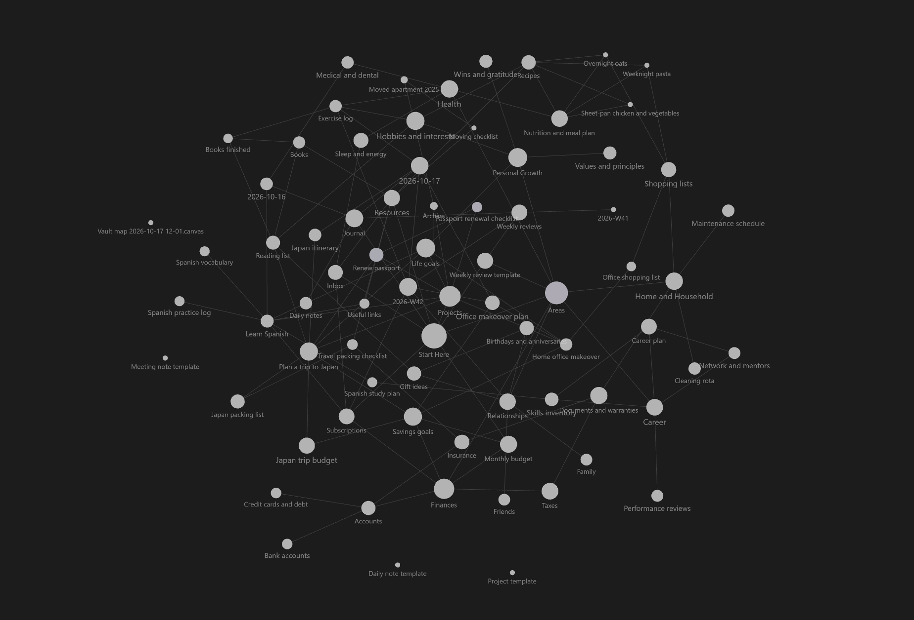

# Outlink Node Size
> Size graph view nodes by the combined size of the notes they link to.

Obsidian's graph sizes nodes by how many links they have. This plugin does something different: a note grows when it links to _big_ notes, and notes that link to nothing stay small. It is the inverse of how Google ranks pages, where a page is important because others link _to_ it. Here, a note is big because of what it links _out_ to.

It changes **only node size**. Colors, forces, labels, filters and groups are left alone.




## What it's good for
- Spotting **hub and index notes** (maps of content, overviews, project pages) that gather lots of other material.
- Seeing which notes sit **on top of the largest clusters**, not just which are most referenced.
- Telling **leaf notes** (linking to nothing) apart from notes that organize others, at a glance.

## How size is computed
Each note gets a size based on the notes it links to:

```
size(note) = 1 + decay × (sum of size(t) for every note t that this note links to)
```
- A note with no outgoing links has size 1, the smallest.
- A note that links to bigger notes becomes bigger.
- The calculation repeats `depth` times, so each note also picks up size from the notes its linked notes link to. Because the number of rounds is fixed, **link cycles can never make sizes run away**.
- The results are mapped onto a display range between your smallest and largest node size.

Sizes are computed from your **whole vault**, so changing graph filters, search, or local graph depth won't change them. Obsidian's own **Node size** slider in the graph settings still scales everything.

## Installation

### From the community plugin directory
Once approved: **Settings → Community plugins → Browse**, search for **Outlink Node Size**, then install and enable it.

### Manual install
1. Download `main.js` and `manifest.json` from the [latest release](https://github.com/goncasCartaxana/outlink-node-size/releases/latest).
2. Create the folder `<your vault>/.obsidian/plugins/outlink-node-size/` and put both files in it.
3. In Obsidian, go to **Settings → Community plugins**, reload the list, and enable **Outlink Node Size**.
4. Open the graph view (global or local).


## Settings
| Setting | What it does | Default |
| --- | --- | --- |
| **Enable outlink sizing** | Turn off to get Obsidian's stock node sizes back. | On |
| **Propagation depth** | How many link-hops are followed. `1` means only a note's direct links count; higher values let it inherit size from notes further down the chain. | 3 |
| **Decay** | How much of a linked note's size is passed up to the note that links to it. Lower values make distant links matter less. | 0.5 |
| **Count repeated links** | Count every link to the same target instead of counting each target once. | Off |
| **Include attachments** | Let links and embeds of images, PDFs and other non-note files add to a note's size. | Off |
| **Scale** | How size maps onto the display range: logarithmic, square root, linear, or percentile rank. | Logarithmic |
| **Smallest node** | Display size of a note that links to nothing. Obsidian's default range is roughly 8 to 30. | 6 |
| **Largest node** | Display size of the note with the greatest aggregate outlink size. | 40 |

There is also a command, **Toggle outlink-based node sizing**, which you can bind to a hotkey.

### Tuning tips
- **Only direct links matter:** set depth to `1` and decay to `1`. A note's size is then 1 plus its number of outgoing links.
- **Big hubs dominate everything:** use *Logarithmic* or *Percentile rank*. Linear scaling lets one huge note flatten all the others.
- **Want even more spread between notes:** use *Percentile rank*. It ignores the actual numbers and spreads notes evenly from smallest to largest.
- **Everything looks the same size:** raise *Largest node*, or lower *Smallest node*.

## Good to know
- Tag nodes and unresolved-link ("ghost") nodes have no outgoing links, so they are drawn at the smallest size.
- Sizes update automatically when you add, remove, rename or edit links.
- Your links are read from Obsidian's own link index. The plugin makes no network requests and does not modify any notes.

## Compatibility and limitations
Obsidian has no public API for customizing the graph, so this plugin hooks the graph renderer's internal node-sizing function. That has two consequences:
- **A future Obsidian update could break it.** If that happens, the graph should fall back to its stock look. Please open an issue with your Obsidian version.
- **It conflicts with other plugins that also change node size**, such as the node-size options in Extended Graph. Use one or the other.

Developed against Obsidian desktop. Mobile has not been tested.

## Development
```bash
git clone https://github.com/goncasCartaxana/outlink-node-size.git
cd outlink-node-size
npm install        # Run to install required external packages
npm run dev        # rebuilds main.js on every change
npm run build      # type-check and produce a minified main.js
```

To try your build, copy `main.js` and `manifest.json` into `<vault>/.obsidian/plugins/outlink-node-size/` and reload Obsidian.

The code is small:
- `src/sizes.ts` contains the size calculation. It has no Obsidian dependency.
- `src/main.ts` contains the graph hooks and the settings tab.

### Releasing
1. Run `npm version patch` (or `minor` / `major`). This updates `package.json`, `manifest.json` and `versions.json`, then commits and tags the release, for example `1.0.1`.
2. Run `git push --follow-tags`.
3. The [release workflow](.github/workflows/release.yml) builds the plugin and publishes a GitHub release with `main.js` and `manifest.json` attached.

The release tag must exactly match the `version` in `manifest.json`, with no leading `v`. Obsidian uses this to find the files to install.

## Issues and feedback
Found a bug or have an idea? [Open an issue](https://github.com/goncasCartaxana/outlink-node-size/issues). Including your Obsidian version and the plugin settings you used helps a lot.

## License
[MIT](LICENSE)
